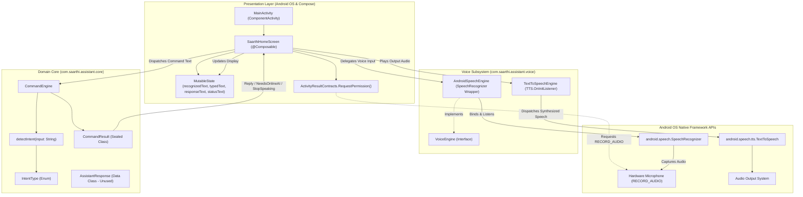
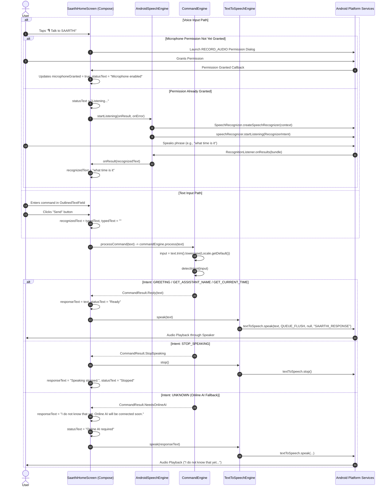
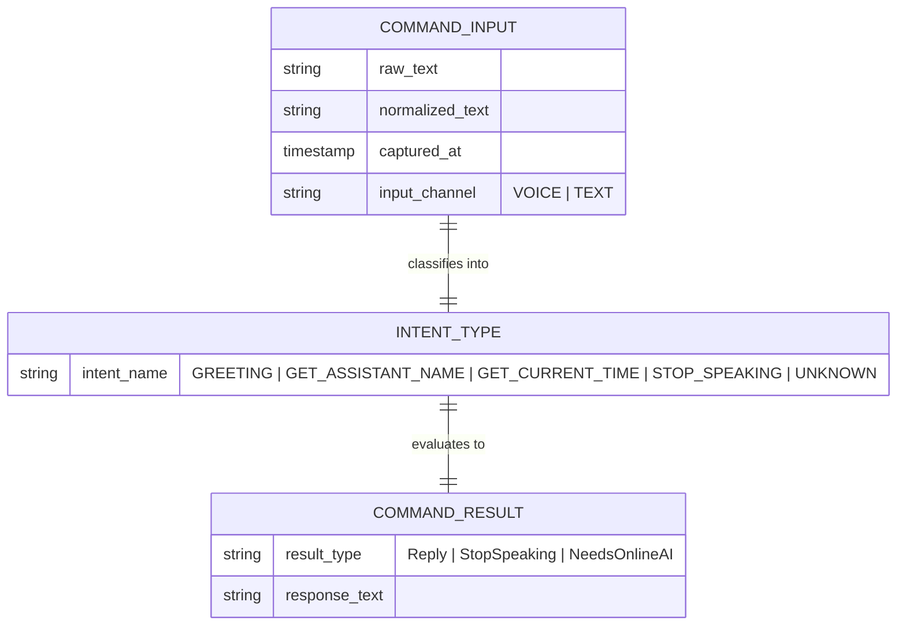
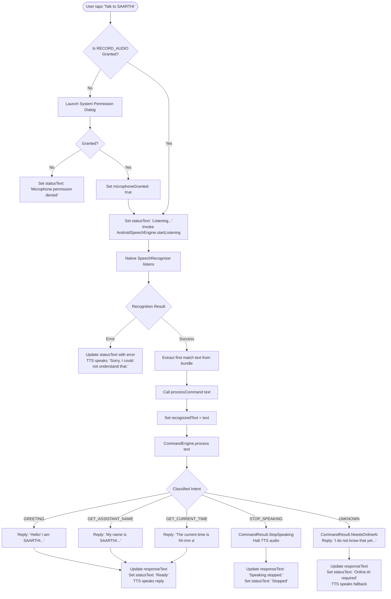

# Technical Architecture and Forensic Audit: SAARTHI — Your Private AI Assistant

**Document Identifier:** `SAARTHI-DOC-AUDIT-001`  
**Audit Mode:** Complete Forensic Technical Inspection (Strict Read-Only)  
**Target Repository:** `d:\SAARTHI - Your Private AI Assistant`  
**Package / Namespace:** `com.saarthi.assistant`  
**Inspection Date:** October 24, 2026  
**Auditor:** Antigravity Forensic Engineering  

---

## Table of Contents

1. [Executive Summary](#1-executive-summary)
2. [Project Inventory](#2-project-inventory)
3. [Technology Stack](#3-technology-stack)
4. [Architecture Overview](#4-architecture-overview)
5. [Application Bootstrap and Request Lifecycle](#5-application-bootstrap-and-request-lifecycle)
6. [Feature and Module Catalog](#6-feature-and-module-catalog)
7. [Database Documentation](#7-database-documentation)
8. [End-to-End Workflow Documentation](#8-end-to-end-workflow-documentation)
9. [API and Integration Inventory](#9-api-and-integration-inventory)
10. [Authentication and Authorization](#10-authentication-and-authorization)
11. [Configuration and Deployment Guide](#11-configuration-and-deployment-guide)
12. [Security and Reliability Audit](#12-security-and-reliability-audit)
13. [Code Quality and Technical Debt](#13-code-quality-and-technical-debt)
14. [Known Bugs and Incomplete Features](#14-known-bugs-and-incomplete-features)
15. [Dependency and Compatibility Report](#15-dependency-and-compatibility-report)
16. [Testing and Verification Status](#16-testing-and-verification-status)
17. [File-to-Feature Cross-Reference](#17-file-to-feature-cross-reference)
18. [Prioritized Recommendations](#18-prioritized-recommendations)
19. [Investigation Limitations](#19-investigation-limitations)

---

## 1. Executive Summary

### 1.1 Application Overview
**SAARTHI** is an Android mobile application engineered as an offline-first, privacy-centric voice and text conversational assistant. Derived from the Sanskrit concept of "Saarthi" (a trusted guide or charioteer), the application provides natural voice and text interactions, local rule-based intent recognition, and audio synthesis without exfiltrating private conversational data to cloud providers during offline operation.

### 1.2 Current State of Implementation
The application is in an early functional prototype / Alpha development stage:
- **User Interface:** Single Activity (`MainActivity.kt`) using Jetpack Compose and Material 3 design primitives.
- **Voice Pipeline:** Bi-directional voice integration utilizing Android platform speech APIs (`android.speech.SpeechRecognizer` for Automatic Speech Recognition (ASR) and `android.speech.tts.TextToSpeech` for speech synthesis).
- **Core Engine:** Local offline rule-based deterministic intent processing (`CommandEngine.kt`) handling initial intents (Greeting, Assistant Identity, Current Time, and Speech Cancellation).
- **Network & Online AI:** Planned fallback mechanism (`CommandResult.NeedsOnlineAI`), returning stubbed status indicators ("I do not know that yet. Online AI will be connected soon."). The network integration layer, HTTP client, and Internet permissions are not yet implemented.
- **Persistence & Storage:** Zero local persistent storage (no SQLite, Room, DataStore, or SharedPreferences). Application state resides entirely within transient Jetpack Compose `remember` state containers.

### 1.3 Key Forensic Findings
1. **Unwrapped UI Theming:** The application defines a complete custom Compose theme in `ui/theme/Theme.kt` (`SAARTHITheme` with dynamic Material You coloring for Android 12+), but `MainActivity.kt` sets `setContent { SaarthiHomeScreen() }` without wrapping it in `SAARTHITheme`.
2. **Missing Internet Permission:** While `NeedsOnlineAI` is present in the domain model and returns a prompt indicating future online AI connectivity, `AndroidManifest.xml` lacks `<uses-permission android:name="android.permission.INTERNET" />`.
3. **SpeechRecognizer Allocation Lifecycle:** `AndroidSpeechEngine.kt` instantiates a new `SpeechRecognizer` object on every invocation of `startListening(...)` without destroying or recycling existing instances, leading to potential callback leaks and resource thrashing.
4. **Configuration Change Volatility:** UI state (`recognizedText`, `typedText`, `responseText`, `statusText`) uses `remember { mutableStateOf(...) }` rather than `rememberSaveable` or an Android Architecture Component `ViewModel`. Device rotation or configuration change destroys and recreates the Activity, wiping conversational context.
5. **Orphaned Domain Model:** The data class `AssistantResponse.kt` is defined but completely unreferenced across the codebase.

---

## 2. Project Inventory

### 2.1 Workspace Structure
The workspace root directory is `d:\SAARTHI - Your Private AI Assistant` and contains three top-level directories:
- `android/` — The primary Android native source tree, Gradle build scripts, resources, and build output artifacts.
- `.vscode/` — VS Code configuration settings.
- `docs/` — Designated project technical documentation directory.

```
d:\SAARTHI - Your Private AI Assistant
├── .vscode/
│   └── settings.json
├── docs/
│   └── PROJECT_TECHNICAL_DOCUMENTATION.md (this forensic documentation)
└── android/
    ├── .gitignore
    ├── build.gradle.kts
    ├── gradle.properties
    ├── gradlew
    ├── gradlew.bat
    ├── local.properties
    ├── settings.gradle.kts
    ├── gradle/
    │   ├── gradle-daemon-jvm.properties
    │   ├── libs.versions.toml
    │   └── wrapper/
    │       ├── gradle-wrapper.jar
    │       └── gradle-wrapper.properties
    └── app/
        ├── .gitignore
        ├── build.gradle.kts
        ├── src/
        │   ├── main/
        │   │   ├── AndroidManifest.xml
        │   │   ├── keepRules/
        │   │   │   └── rules.keep
        │   │   ├── java/com/saarthi/assistant/
        │   │   │   ├── MainActivity.kt
        │   │   │   ├── core/
        │   │   │   │   ├── AssistantResponse.kt
        │   │   │   │   ├── CommandEngine.kt
        │   │   │   │   ├── CommandResult.kt
        │   │   │   │   └── IntentType.kt
        │   │   │   ├── ui/theme/
        │   │   │   │   ├── Color.kt
        │   │   │   │   ├── Theme.kt
        │   │   │   │   └── Type.kt
        │   │   │   └── voice/
        │   │   │       ├── AndroidSpeechEngine.kt
        │   │   │       ├── TextToSpeechEngine.kt
        │   │   │       └── VoiceEngine.kt
        │   │   └── res/
        │   │       ├── drawable/
        │   │       │   ├── ic_launcher_background.xml
        │   │       │   └── ic_launcher_foreground.xml
        │   │       ├── mipmap-anydpi/
        │   │       │   ├── ic_launcher.xml
        │   │       │   └── ic_launcher_round.xml
        │   │       ├── mipmap-hdpi/
        │   │       │   ├── ic_launcher.webp
        │   │       │   └── ic_launcher_round.webp
        │   │       ├── mipmap-mdpi/
        │   │       │   ├── ic_launcher.webp
        │   │       │   └── ic_launcher_round.webp
        │   │       ├── mipmap-xhdpi/
        │   │       │   ├── ic_launcher.webp
        │   │       │   └── ic_launcher_round.webp
        │   │       ├── mipmap-xxhdpi/
        │   │       │   ├── ic_launcher.webp
        │   │       │   └── ic_launcher_round.webp
        │   │       ├── mipmap-xxxhdpi/
        │   │       │   ├── ic_launcher.webp
        │   │       │   └── ic_launcher_round.webp
        │   │       ├── values/
        │   │       │   ├── colors.xml
        │   │       │   ├── strings.xml
        │   │       │   └── themes.xml
        │   │       └── xml/
        │   │           ├── backup_rules.xml
        │   │           └── data_extraction_rules.xml
        │   ├── test/java/com/saarthi/assistant/
        │   │   ├── ExampleUnitTest.kt
        │   │   └── core/
        │   │       └── CommandEngineTest.kt
        │   └── androidTest/java/com/saarthi/assistant/
        │       └── ExampleInstrumentedTest.kt
        └── build/ (pre-existing build outputs and cached test reports)
```

### 2.2 Detailed Source File Inventory

| Relative File Path | Category | Byte Size | Lines | Purpose & Description |
|---|---|---|---|---|
| `android/app/src/main/AndroidManifest.xml` | Manifest | 1,123 B | 30 | Application manifest, declares `RECORD_AUDIO`, MainActivity, theme, and backup rules. |
| `android/app/src/main/java/com/saarthi/assistant/MainActivity.kt` | UI / Controller | 6,783 B | 255 | Root Activity, Compose UI layout (`SaarthiHomeScreen`), speech callbacks, permission launcher. |
| `android/app/src/main/java/com/saarthi/assistant/core/CommandEngine.kt` | Domain Logic | 2,104 B | 84 | Rule-based string parsing, intent detection (`detectIntent`), and result creation. |
| `android/app/src/main/java/com/saarthi/assistant/core/CommandResult.kt` | Domain Model | 246 B | 12 | Sealed class hierarchy (`Reply`, `StopSpeaking`, `NeedsOnlineAI`). |
| `android/app/src/main/java/com/saarthi/assistant/core/IntentType.kt` | Domain Model | 160 B | 9 | Enumeration of intents: `GREETING`, `GET_ASSISTANT_NAME`, `GET_CURRENT_TIME`, `STOP_SPEAKING`, `UNKNOWN`. |
| `android/app/src/main/java/com/saarthi/assistant/core/AssistantResponse.kt` | Domain Model | 220 B | 8 | Data class with flags (`text`, `shouldSpeak`, `shouldStopSpeaking`, `requiresOnlineAi`). Currently unused. |
| `android/app/src/main/java/com/saarthi/assistant/voice/VoiceEngine.kt` | Voice Abstraction | 232 B | 13 | Interface abstraction defining `startListening`, `stopListening`, and `isListening`. |
| `android/app/src/main/java/com/saarthi/assistant/voice/AndroidSpeechEngine.kt` | Voice Service | 4,673 B | 161 | Concrete implementation of `VoiceEngine` wrapping Android SDK `SpeechRecognizer`. |
| `android/app/src/main/java/com/saarthi/assistant/voice/TextToSpeechEngine.kt` | Audio Service | 1,140 B | 48 | Text-to-speech engine wrapping `android.speech.tts.TextToSpeech`. |
| `android/app/src/main/java/com/saarthi/assistant/ui/theme/Color.kt` | UI Styling | 285 B | 11 | Color definitions (`Purple80`, `PurpleGrey80`, `Pink80`, `Purple40`, `PurpleGrey40`, `Pink40`). |
| `android/app/src/main/java/com/saarthi/assistant/ui/theme/Theme.kt` | UI Styling | 1,696 B | 58 | Dynamic Material 3 theme (`SAARTHITheme`) with system dark mode and Android 12+ dynamic color. |
| `android/app/src/main/java/com/saarthi/assistant/ui/theme/Type.kt` | UI Styling | 990 B | 34 | Material 3 typography definitions. |
| `android/app/src/test/java/com/saarthi/assistant/core/CommandEngineTest.kt` | Unit Test | 1,444 B | 67 | JUnit 4 unit tests verifying deterministic responses of `CommandEngine`. |
| `android/app/src/test/java/com/saarthi/assistant/ExampleUnitTest.kt` | Unit Test | 345 B | 17 | Template boilerplate unit test verifying 2 + 2 == 4. |
| `android/app/src/androidTest/java/com/saarthi/assistant/ExampleInstrumentedTest.kt` | Instrumented Test | 669 B | 24 | AndroidJUnit4 instrumented test verifying target context package name. |
| `android/app/src/main/res/values/strings.xml` | Resource | 69 B | 3 | Defines `app_name` string ("SAARTHI"). |
| `android/app/src/main/res/values/colors.xml` | Resource | 378 B | 10 | Legacy Android XML color definitions from standard template. |
| `android/app/src/main/res/values/themes.xml` | Resource | 149 B | 5 | Base Android theme definition inheriting from `android:Theme.Material.Light.NoActionBar`. |
| `android/app/src/main/res/xml/backup_rules.xml` | Configuration | 478 B | 13 | Backup descriptor for Android auto-backup. |
| `android/app/src/main/res/xml/data_extraction_rules.xml` | Configuration | 551 B | 19 | Cloud backup and device-to-device transfer rule configuration. |
| `android/app/src/main/keepRules/rules.keep` | Build Config | 418 B | 12 | Project-specific R8 ProGuard keep rules descriptor. |
| `android/gradle/libs.versions.toml` | Build Catalog | 1,749 B | 32 | Gradle Version Catalog defining dependencies, plugins, and library coordinates. |
| `android/build.gradle.kts` | Root Build Script | 218 B | 5 | Top-level project Gradle build configuration declaring plugins with `apply false`. |
| `android/settings.gradle.kts` | Build Settings | 618 B | 27 | Gradle repository configuration, project name declaration, plugin repositories. |
| `android/app/build.gradle.kts` | App Build Script | 1,593 B | 54 | App module Gradle build file: SDK versions, dependencies, Compose compiler. |
| `android/gradle.properties` | Build Properties | 1,120 B | 19 | JVM memory configuration (`-Xmx2048m`), configuration caching, Kotlin code style. |
| `android/gradle/wrapper/gradle-wrapper.properties` | Build Wrapper | 384 B | 10 | Gradle 9.5.0 binary distribution configuration and SHA256 checksum. |
| `android/gradle/gradle-daemon-jvm.properties` | Toolchain Config | 1,138 B | 13 | Foojay disco API JDK 25 toolchain resolution configuration. |
| `android/local.properties` | Local Config | 448 B | 10 | Machine-specific Android SDK location path (`C:\Users\Dell\AppData\Local\Android\Sdk`). |
| `.vscode/settings.json` | IDE Config | 70 B | 3 | VS Code Java configuration setting (`updateBuildConfiguration: interactive`). |

---

## 3. Technology Stack

### 3.1 Core Technologies and Versions

| Layer / Subsystem | Technology | Version | Verification Evidence |
|---|---|---|---|
| **Programming Language** | Kotlin | `2.2.10` | `android/gradle/libs.versions.toml:9` |
| **Build System** | Gradle Wrapper | `9.5.0` | `android/gradle/wrapper/gradle-wrapper.properties:5` |
| **Android Build Tool** | Android Gradle Plugin (AGP) | `9.3.2` | `android/gradle/libs.versions.toml:2` |
| **Java Platform / Toolchain** | OpenJDK / Foojay Toolchain | `25` (Targeting Java 11) | `gradle-daemon-jvm.properties:12`, `app/build.gradle.kts:30-31` |
| **UI Toolkit** | Jetpack Compose | BOM `2026.02.01` | `android/gradle/libs.versions.toml:10` |
| **Compose Compiler Plugin** | Kotlin Compose Plugin | `2.2.10` | `android/gradle/libs.versions.toml:30` |
| **Design System** | Material Design 3 (Material3) | Via Compose BOM | `android/app/build.gradle.kts:41` |
| **Activity Integration** | AndroidX Activity Compose | `1.8.0` | `android/gradle/libs.versions.toml:8` |
| **Core Utilities** | AndroidX Core KTX | `1.10.1` | `android/gradle/libs.versions.toml:3` |
| **Lifecycle Runtime** | AndroidX Lifecycle Runtime KTX | `2.6.1` | `android/gradle/libs.versions.toml:7` |
| **Speech-to-Text (ASR)** | Android SpeechRecognizer API | Platform Native (API 26+) | `android/app/src/main/java/.../voice/AndroidSpeechEngine.kt` |
| **Text-to-Speech (TTS)** | Android TextToSpeech API | Platform Native (API 26+) | `android/app/src/main/java/.../voice/TextToSpeechEngine.kt` |
| **Unit Testing** | JUnit 4 | `4.13.2` | `android/gradle/libs.versions.toml:4` |
| **Instrumentation Testing**| AndroidX JUnit / Espresso Core | `1.1.5` / `3.5.1` | `android/gradle/libs.versions.toml:5-6` |
| **Database / Persistence** | None (In-Memory transient state) | N/A | Forensic code inspection confirmed absence |

### 3.2 Compilation and Target SDK Specifications
- **Compile SDK:** 36 (declared via `compileSdk { version = release(36) }` in `android/app/build.gradle.kts:8-10`)
- **Min SDK:** 26 (Android 8.0 Oreo, ensuring universal native `SpeechRecognizer` and `TextToSpeech` API support)
- **Target SDK:** 36 (Android 16 preview / Android 36)
- **Bytecode Target:** Java 11 bytecode compatibility (`JavaVersion.VERSION_11` in `android/app/build.gradle.kts:30-31`)
- **Shrinking / Obfuscation:** R8 release optimizations disabled (`buildTypes.release.optimization.enable = false` in `android/app/build.gradle.kts:24-26`)

---

## 4. Architecture Overview

### 4.1 Architectural Pattern
The application follows a lightweight reactive single-activity pattern:
- **Presentation Layer:** Jetpack Compose declarative UI located in `MainActivity.kt` (`SaarthiHomeScreen`).
- **Voice Orchestration Layer:** Native platform adapters located in `com.saarthi.assistant.voice`:
  - `VoiceEngine` defines the listening contract.
  - `AndroidSpeechEngine` acts as the speech-to-text coordinator.
  - `TextToSpeechEngine` manages the audio synthesis queue.
- **Domain Layer:** Pure Kotlin offline deterministic intent engine located in `com.saarthi.assistant.core`:
  - `CommandEngine` parses textual input, normalizes strings, and produces `CommandResult`.
  - `IntentType` enumerates supported command intents.
  - `CommandResult` models downstream UI and audio actions.
- **Data / Storage Layer:** Absent. There is no local database or network repository.

### 4.2 Architecture Diagram



---

## 5. Application Bootstrap and Request Lifecycle

### 5.1 Bootstrap Sequence

1. **OS Process Creation:** Android zygote forks the application process `com.saarthi.assistant`.
2. **Manifest Resolution:** The Android OS reads `android/app/src/main/AndroidManifest.xml`, identifies `MainActivity` as the exported `MAIN` / `LAUNCHER` activity with theme `@style/Theme.SAARTHI`.
3. **Activity Launch:** `MainActivity.onCreate(savedInstanceState: Bundle?)` executes (`MainActivity.kt:36-43`):
   ```kotlin
   override fun onCreate(savedInstanceState: android.os.Bundle?) {
       super.onCreate(savedInstanceState)
       setContent {
           SaarthiHomeScreen()
       }
   }
   ```
4. **Composition Initialization:** `SaarthiHomeScreen()` enters composition (`MainActivity.kt:45-93`):
   - Extracts current context: `LocalContext.current`.
   - Queries initial microphone permission status via `ContextCompat.checkSelfPermission(context, Manifest.permission.RECORD_AUDIO)`.
   - Initializes reactive Compose state holders (`recognizedText`, `typedText`, `responseText`, `statusText`).
   - Allocates instances of `AndroidSpeechEngine(context)`, `TextToSpeechEngine(context)`, and `CommandEngine()` via `remember { ... }`.
   - `TextToSpeechEngine` invokes native `TextToSpeech(context.applicationContext, this)` which asynchronously binds to the platform TTS engine and executes `onInit(status: Int)`.
   - Sets up `DisposableEffect(Unit)` with `onDispose { speechEngine.release(); textToSpeechEngine.release() }`.
5. **View Hierarchy Render:** Jetpack Compose computes the initial layout tree consisting of the title headers, status display, input text field, "Send" button, and "Talk to SAARTHI" action button.

### 5.2 Command Request Lifecycle



---

## 6. Feature and Module Catalog

### 6.1 Implemented Features

#### Feature 1: Deterministic Conversational Core (`CommandEngine`)
- **Status:** Fully Implemented (Offline).
- **Files Involved:**
  - `android/app/src/main/java/com/saarthi/assistant/core/CommandEngine.kt`
  - `android/app/src/main/java/com/saarthi/assistant/core/CommandResult.kt`
  - `android/app/src/main/java/com/saarthi/assistant/core/IntentType.kt`
- **Execution Flow:** `process(command: String)` normalizes text via `trim().lowercase(Locale.getDefault())`, executes `detectIntent(input)`, and returns a sealed `CommandResult` object.
- **Rule Set:**
  1. `input == "hello" || input == "hi" || input == "hey"` $\rightarrow$ `IntentType.GREETING` $\rightarrow$ `Reply("Hello! I am SAARTHI. How can I help you?")`
  2. `input.contains("what is your name") || input.contains("your name")` $\rightarrow$ `IntentType.GET_ASSISTANT_NAME` $\rightarrow$ `Reply("My name is SAARTHI, your private AI assistant.")`
  3. `input == "time" || input.contains("what time") || input.contains("current time")` $\rightarrow$ `IntentType.GET_CURRENT_TIME` $\rightarrow$ `Reply("The current time is " + SimpleDateFormat("hh:mm a", Locale.getDefault()).format(Date()))`
  4. `input == "stop" || input == "stop speaking"` $\rightarrow$ `IntentType.STOP_SPEAKING` $\rightarrow$ `CommandResult.StopSpeaking`
  5. Any other string $\rightarrow$ `IntentType.UNKNOWN` $\rightarrow$ `CommandResult.NeedsOnlineAI`

#### Feature 2: Voice Recognition Pipeline (`AndroidSpeechEngine`)
- **Status:** Fully Implemented (Native wrapper).
- **Files Involved:**
  - `android/app/src/main/java/com/saarthi/assistant/voice/VoiceEngine.kt`
  - `android/app/src/main/java/com/saarthi/assistant/voice/AndroidSpeechEngine.kt`
  - `android/app/src/main/AndroidManifest.xml` (permission declaration)
- **Execution Flow:** 
  1. Checks `SpeechRecognizer.isRecognitionAvailable(context)`.
  2. Creates `SpeechRecognizer` and attaches `RecognitionListener`.
  3. Configures `RecognizerIntent.ACTION_RECOGNIZE_SPEECH` with `LANGUAGE_MODEL_FREE_FORM` and `EXTRA_MAX_RESULTS = 3`.
  4. Dispatches results via `onResult(String)` or errors via `onError(String)` with localized error mappings (`ERROR_AUDIO`, `ERROR_CLIENT`, `ERROR_NETWORK`, `ERROR_NO_MATCH`, etc.).

#### Feature 3: Speech Synthesis Engine (`TextToSpeechEngine`)
- **Status:** Fully Implemented (Native wrapper).
- **Files Involved:**
  - `android/app/src/main/java/com/saarthi/assistant/voice/TextToSpeechEngine.kt`
- **Execution Flow:**
  1. Binds `android.speech.tts.TextToSpeech` against `context.applicationContext`.
  2. On initialization callback `onInit(status)`, sets language to `Locale.getDefault()`.
  3. Validates against `LANG_MISSING_DATA` and `LANG_NOT_SUPPORTED`.
  4. `speak(text)` submits audio rendering with `TextToSpeech.QUEUE_FLUSH` using utterance ID `"SAARTHI_RESPONSE"`.
  5. `stop()` halts ongoing speech; `release()` shuts down the underlying TTS engine.

#### Feature 4: Text-Based Conversational Interface
- **Status:** Fully Implemented.
- **Files Involved:**
  - `android/app/src/main/java/com/saarthi/assistant/MainActivity.kt:175-196`
- **Execution Flow:** User inputs alphanumeric text into `OutlinedTextField`. Clicking "Send" invokes `processCommand(typedText)` and resets the text buffer.

#### Feature 5: Runtime Audio Permission Handling
- **Status:** Fully Implemented.
- **Files Involved:**
  - `android/app/src/main/java/com/saarthi/assistant/MainActivity.kt:50-57, 94-106, 215-253`
- **Execution Flow:** Inspects `ContextCompat.checkSelfPermission(...)`. If missing, the "Talk to SAARTHI" button dynamically changes label to "🎙 Enable Microphone" and triggers `rememberLauncherForActivityResult(ActivityResultContracts.RequestPermission())`.

### 6.2 Partially Implemented / Stubbed Features

#### Feature 6: Online AI Integration
- **Status:** Stubbed / Partially Implemented.
- **Files Involved:**
  - `android/app/src/main/java/com/saarthi/assistant/core/CommandResult.kt:11`
  - `android/app/src/main/java/com/saarthi/assistant/MainActivity.kt:136-146`
- **Observed Evidence:** Unmatched queries resolve to `CommandResult.NeedsOnlineAI`. The UI handles this state by displaying and speaking `"I do not know that yet. Online AI will be connected soon."` and setting `statusText = "Online AI required"`.
- **Missing Elements:** No network library (Retrofit, Ktor, OkHttp) is present in `libs.versions.toml`, no API clients or keys exist, and `android.permission.INTERNET` is absent from `AndroidManifest.xml`.

### 6.3 Orphaned / Unused Code Artifacts

#### Artifact 1: `AssistantResponse` Data Class
- **Status:** Unused / Dead Code.
- **File:** `android/app/src/main/java/com/saarthi/assistant/core/AssistantResponse.kt`
- **Code Inspection:**
  ```kotlin
  data class AssistantResponse(
      val text: String,
      val shouldSpeak: Boolean = true,
      val shouldStopSpeaking: Boolean = false,
      val requiresOnlineAi: Boolean = false
  )
  ```
- **Finding:** A full project grep confirms this class is neither instantiated nor imported outside its own declaration file. It appears to be an earlier or alternate domain representation that was replaced by the sealed class `CommandResult`.

#### Artifact 2: Template Resource Colors
- **Status:** Unused Resource.
- **File:** `android/app/src/main/res/values/colors.xml`
- **Finding:** Contains `purple_200`, `purple_500`, `purple_700`, `teal_200`, `teal_700`, `black`, `white`. None are referenced in Compose UI (`Color.kt` defines `Purple80`, `Purple40`, etc.), nor in `themes.xml`.

---

## 7. Database Documentation

### 7.1 Database Engine Verification
- **Database Engine:** **None.**
- **Verification Method:** Exhaustive static grep and dependency analysis of `build.gradle.kts`, `libs.versions.toml`, and all Kotlin source files.
- **Result:** No SQL databases, SQLite drivers, Room persistence libraries, Realm, SQLDelight, or ObjectBox dependencies exist in the repository.

### 7.2 Persistence Analysis and State Lifecycle
The application operates entirely statelessly across process lifecycles. All application state is stored in memory via Compose state variables inside `MainActivity.kt`:

| State Variable | Type | Container | Scope / Lifecycle |
|---|---|---|---|
| `microphoneGranted` | `Boolean` | `remember { mutableStateOf(...) }` | Destroyed on Activity recreation |
| `recognizedText` | `String` | `remember { mutableStateOf("") }` | Destroyed on Activity recreation |
| `typedText` | `String` | `remember { mutableStateOf("") }` | Destroyed on Activity recreation |
| `responseText` | `String` | `remember { mutableStateOf("") }` | Destroyed on Activity recreation |
| `statusText` | `String` | `remember { mutableStateOf("Ready") }` | Destroyed on Activity recreation |

### 7.3 Conceptual Domain Entity Model
Although no relational database exists, the domain model entities and their relationships can be modeled as follows:



---

## 8. End-to-End Workflow Documentation

### 8.1 Workflow 1: Voice Command Processing



### 8.2 Workflow 2: Text Command Processing
1. **User Action:** User taps `OutlinedTextField` and enters query string.
2. **Submit:** User taps "Send" button (`MainActivity.kt:188-196`).
3. **Guard Clause:** `processCommand(text)` checks `if (text.isBlank()) return`.
4. **State Transition:** `recognizedText` is populated with `typedText`; `typedText` is reset to `""`.
5. **Execution:** `CommandEngine.process(text)` resolves intent and returns `CommandResult`.
6. **Output Delivery:** `responseText` is updated in UI; `TextToSpeechEngine.speak(result.text)` flushes current speech queue and plays synthesized audio.

### 8.3 Workflow 3: Speech Cancellation Flow
1. **Trigger Condition:** User says or types "stop" or "stop speaking" while TTS audio is playing.
2. **Intent Match:** `CommandEngine.detectIntent` matches `input == "stop" || input == "stop speaking"` $\rightarrow$ `IntentType.STOP_SPEAKING`.
3. **Execution:** `processCommand` matches `CommandResult.StopSpeaking` (`MainActivity.kt:128-134`).
4. **Action:** Invokes `textToSpeechEngine.stop()`, which calls `android.speech.tts.TextToSpeech.stop()`.
5. **UI Update:** Sets `responseText = "Speaking stopped."`, `statusText = "Stopped"`.

---

## 9. API and Integration Inventory

### 9.1 External Web / Cloud APIs
- **Current Status:** **None.** The application does not communicate with any external REST, GraphQL, WebSocket, or gRPC servers.
- **Verification Evidence:** No network permissions in `AndroidManifest.xml`; zero HTTP client libraries in `libs.versions.toml`.

### 9.2 Android Platform System Integrations

| Platform API | Purpose | Native Class / Framework | Implementation File | Permissions Required |
|---|---|---|---|---|
| **Speech Recognition** | Speech-to-Text conversion | `android.speech.SpeechRecognizer` | `voice/AndroidSpeechEngine.kt` | `android.permission.RECORD_AUDIO` |
| **Speech Recognizer Intent** | ASR configuration parameters | `android.speech.RecognizerIntent` | `voice/AndroidSpeechEngine.kt` | None |
| **Speech Listener** | Asynchronous recognition event callbacks | `android.speech.RecognitionListener` | `voice/AndroidSpeechEngine.kt` | None |
| **Text-to-Speech Engine** | Voice synthesis playback | `android.speech.tts.TextToSpeech` | `voice/TextToSpeechEngine.kt` | None |
| **TTS Initialization Listener** | Asynchronous TTS engine bind callback | `android.speech.tts.TextToSpeech.OnInitListener` | `voice/TextToSpeechEngine.kt` | None |
| **Activity Result Contracts** | Runtime permission request lifecycle | `androidx.activity.result.contract.ActivityResultContracts` | `MainActivity.kt` | None |

---

## 10. Authentication and Authorization

### 10.1 User Authentication
The application does not implement user accounts, logins, session tokens, passwords, biometrics, or cryptographic keys. All operations are local and anonymous.

### 10.2 Android OS Authorization (Permissions)

| Permission Identifier | Protection Level | Declared in Manifest | Runtime Prompt Implemented | Purpose & Scope |
|---|---|---|---|---|
| `android.permission.RECORD_AUDIO` | `dangerous` (runtime) | Yes (`AndroidManifest.xml:5`) | Yes (`MainActivity.kt:94-106`) | Access to device microphone for real-time speech recognition. |
| `android.permission.INTERNET` | `normal` (install-time) | **No (Missing)** | N/A | Required for outbound network requests to online AI backends. |

---

## 11. Configuration and Deployment Guide

### 11.1 Build and Toolchain Requirements
- **Operating System:** Windows 10/11, macOS, or Linux.
- **Java Development Kit (JDK):** JDK 25 recommended by Gradle Toolchain (`gradle-daemon-jvm.properties:12`), with minimum JDK 17 required for Android Gradle Plugin 9.x.
- **Android SDK:**
  - Build Tools: Platform SDK 36.
  - Compile SDK: 36.
  - Min SDK: 26.
  - Target SDK: 36.
- **Gradle Version:** 9.5.0 (managed via included `gradlew` / `gradlew.bat`).

### 11.2 Environment and Properties Configuration
1. `local.properties`: Contains SDK path reference (`sdk.dir=C\:\\Users\\Dell\\AppData\\Local\\Android\\Sdk`).
2. `gradle.properties`:
   - `org.gradle.jvmargs=-Xmx2048m -Dfile.encoding=UTF-8`
   - `org.gradle.configuration-cache=true`
   - `kotlin.code.style=official`
3. `settings.gradle.kts`: Configures Google Maven, MavenCentral, and Gradle Plugin Portal repositories.

### 11.3 Build and Verification Commands (Diagnostic Reference)
To assemble the debug package or execute tests in a development environment:
```bash
# Execute local unit tests
./gradlew testDebugUnitTest

# Assemble debug APK
./gradlew assembleDebug

# Output APK path:
# android/app/build/outputs/apk/debug/app-debug.apk
```

---

## 12. Security and Reliability Audit

### 12.1 Findings Summary Matrix

| ID | Finding Description | Affected Component | Line Reference | Severity | Verification Status |
|---|---|---|---|---|---|
| **SEC-01** | Missing Network Security & Manifest Permission for Online AI | `AndroidManifest.xml` | `AndroidManifest.xml:5-7` | Medium | **Verified** |
| **REL-01** | Multiple `SpeechRecognizer` Allocations Causing Callback/Resource Leak | `AndroidSpeechEngine.kt` | `AndroidSpeechEngine.kt:30` | High | **Verified** |
| **REL-02** | Configuration Change UI State Wipe | `MainActivity.kt` | `MainActivity.kt:50-73` | Medium | **Verified** |
| **REL-03** | Potential Activity Context Leak in Speech Engine | `MainActivity.kt` / `AndroidSpeechEngine.kt` | `MainActivity.kt:75-77` | Medium | **Verified** |
| **REL-04** | Locale-Sensitive Lowercasing in Command Matching | `CommandEngine.kt` | `CommandEngine.kt:13` | Low | **Verified** |
| **REL-05** | Fragile Exact-Match Keyword Parsing | `CommandEngine.kt` | `CommandEngine.kt:55-82` | Medium | **Verified** |
| **SEC-02** | Unrestricted Backup Configuration | `AndroidManifest.xml` / `backup_rules.xml` | `AndroidManifest.xml:8-10` | Low | **Verified** |

### 12.2 Detailed Forensic Findings

#### SEC-01: Missing Internet Permission for Online AI Architecture
- **Observed Evidence:** `AndroidManifest.xml` only requests `android.permission.RECORD_AUDIO`. `CommandResult.NeedsOnlineAI` anticipates connecting to online AI services.
- **Potential Impact:** When backend network calls are introduced, the application will crash with a runtime `SecurityException: Permission Denial: requires android.permission.INTERNET`.
- **Severity:** Medium.

#### REL-01: Multiple SpeechRecognizer Allocations Causing Resource Thrashing
- **Observed Evidence:** In `AndroidSpeechEngine.kt:30`, `startListening(...)` calls:
  ```kotlin
  speechRecognizer = SpeechRecognizer.createSpeechRecognizer(context)
  ```
  without verifying if `speechRecognizer != null` or calling `destroy()` on previous instances.
- **Potential Impact:** Repeatedly clicking "Talk to SAARTHI" allocates unmanaged native binder instances and recognition listeners, leading to memory leaks and erratic recognition events.
- **Severity:** High.

#### REL-02: Volatile In-Composition State Storage
- **Observed Evidence:** In `MainActivity.kt:50-73`, all conversation buffers (`recognizedText`, `typedText`, `responseText`, `statusText`) are stored using `remember { mutableStateOf(...) }`.
- **Potential Impact:** Screen orientation changes, keyboard toggles, or split-screen triggers destroy and recreate `MainActivity`, instantly obliterating the entire conversational history.
- **Severity:** Medium.

#### REL-03: Activity Context Retained in Engine Remember Blocks
- **Observed Evidence:** In `MainActivity.kt:75-77`, `speechEngine` is retained via `remember { AndroidSpeechEngine(context) }` where `context = LocalContext.current` (which resolves to `MainActivity`).
- **Potential Impact:** While `DisposableEffect` calls `release()` on dispose, passing Activity context into long-running speech engine listeners can cause memory leaks during configuration transitions.
- **Severity:** Medium.

#### REL-04: Locale-Sensitive Lowercasing in Command Matching
- **Observed Evidence:** In `CommandEngine.kt:13`:
  ```kotlin
  val input = command.trim().lowercase(Locale.getDefault())
  ```
- **Potential Impact:** Using `Locale.getDefault()` for ASCII intent matching can fail in certain locales (such as Turkish `tr_TR`, where `"HI".lowercase()` becomes `"hı"` without a dot, failing the `"hi"` comparison).
- **Severity:** Low.

#### REL-05: Rigid Pattern Matching in Intent Classifier
- **Observed Evidence:** `detectIntent` in `CommandEngine.kt:55-82` tests:
  ```kotlin
  input == "hello" || input == "hi" || input == "hey"
  ```
- **Potential Impact:** Natural conversational variations such as "Hello Saarthi", "Hey buddy", "Please tell me the time", or "Stop talking" fail to match and prematurely fall through to `NeedsOnlineAI`.
- **Severity:** Medium.

---

## 13. Code Quality and Technical Debt

### 13.1 Architecture and Separation of Concerns
- **Strengths:** 
  - Clear domain decoupling in `com.saarthi.assistant.core`: `CommandEngine` is a pure Kotlin class with zero Android dependencies, making it 100% unit testable on a standard JVM without robolectric or mocks.
  - Interface abstraction `VoiceEngine` defines clear lifecycle boundaries for voice recognition.
- **Deficiencies:**
  - `MainActivity.kt` violates separation of concerns by hosting UI composables, voice engine callbacks, audio lifecycle management, and intent routing in a single file without a `ViewModel`.

### 13.2 UI Theme Integration Disconnect
- `SAARTHITheme` is defined in `ui/theme/Theme.kt:37-58` with complete light/dark color schemes and dynamic color adaptation for Android 12+.
- However, `MainActivity.kt:39-41` completely omits the theme wrapper:
  ```kotlin
  // MainActivity.kt:
  setContent {
      SaarthiHomeScreen() // Theme is never applied!
  }
  ```
  As a result, custom colors defined in `Color.kt` and `Theme.kt` are never rendered.

### 13.3 Dead Code and Unused Assets
1. `com.saarthi.assistant.core.AssistantResponse`: Completely orphaned data class.
2. `android/app/src/main/res/values/colors.xml`: Unreferenced XML colors from project scaffolding.
3. Uncalled interface methods: `stopListening()` and `isListening()` are implemented in `AndroidSpeechEngine.kt` but never invoked in `MainActivity.kt`.

---

## 14. Known Bugs and Incomplete Features

### 14.1 Known Bugs
1. **Unapplied Custom Theme:** `MainActivity.kt` bypasses `SAARTHITheme`.
2. **Missing TTS Completion Callback:** `TextToSpeechEngine.speak(...)` sets `QUEUE_FLUSH`, but there is no `UtteranceProgressListener` to update `statusText` back to "Ready" after speech playback finishes.

### 14.2 Incomplete Features
1. **Online AI Service:** The `NeedsOnlineAI` result state is wired to a hardcoded string response without an actual cloud fallback client.
2. **Conversation History:** No conversational list or message thread view; only the single most recent prompt and response are displayed.
3. **Audio Level Visualization:** `AndroidSpeechEngine.kt:43-45` explicitly contains `// Future: voice level visualization` inside `onRmsChanged`.
4. **Live Streaming Transcription:** `AndroidSpeechEngine.kt:76-80` explicitly notes `// Future: live transcription` inside `onPartialResults`.

---

## 15. Dependency and Compatibility Report

### 15.1 Direct Dependencies Table

| Dependency Coordinate | Version | Scope | Verified In |
|---|---|---|---|
| `androidx.compose:compose-bom` | `2026.02.01` | `implementation(platform)` | `libs.versions.toml:19` |
| `androidx.activity:activity-compose` | `1.8.0` | `implementation` | `libs.versions.toml:18` |
| `androidx.compose.material3:material3` | BOM-managed | `implementation` | `libs.versions.toml:26` |
| `androidx.compose.ui:ui` | BOM-managed | `implementation` | `libs.versions.toml:20` |
| `androidx.compose.ui:ui-graphics` | BOM-managed | `implementation` | `libs.versions.toml:21` |
| `androidx.compose.ui:ui-tooling-preview` | BOM-managed | `implementation` | `libs.versions.toml:23` |
| `androidx.core:core-ktx` | `1.10.1` | `implementation` | `libs.versions.toml:13` |
| `androidx.lifecycle:lifecycle-runtime-ktx` | `2.6.1` | `implementation` | `libs.versions.toml:17` |
| `junit:junit` | `4.13.2` | `testImplementation` | `libs.versions.toml:14` |
| `androidx.test.ext:junit` | `1.1.5` | `androidTestImplementation` | `libs.versions.toml:15` |
| `androidx.test.espresso:espresso-core` | `3.5.1` | `androidTestImplementation` | `libs.versions.toml:16` |
| `androidx.compose.ui:ui-test-junit4` | BOM-managed | `androidTestImplementation` | `libs.versions.toml:25` |
| `androidx.compose.ui:ui-tooling` | BOM-managed | `debugImplementation` | `libs.versions.toml:22` |
| `androidx.compose.ui:ui-test-manifest` | BOM-managed | `debugImplementation` | `libs.versions.toml:24` |

### 15.2 Runtime Compatibility
- **Target OS Compatibility:** Android 8.0 (API level 26) through Android 16 (API level 36).
- **Speech Engine Dependency:** Relies on device OEM having an installed speech recognition service (such as Google Speech Services / Google App). On de-Googled AOSP distributions lacking a speech recognition provider, `SpeechRecognizer.isRecognitionAvailable(context)` returns `false` and triggers the fallback error: `"Speech recognition is not available on this device."`

---

## 16. Testing and Verification Status

### 16.1 Test Suite Analysis

| Test Class | Category | Test Count | Passing | Execution Time | Scope |
|---|---|---|---|---|---|
| `com.saarthi.assistant.core.CommandEngineTest` | Host JVM Unit Test | 5 | 5 | 0.013s | Verifies `greeting`, `name`, `time`, `stop`, and `unknown` intent mappings. |
| `com.saarthi.assistant.ExampleUnitTest` | Host JVM Unit Test | 1 | 1 | 0.007s | Verifies math addition boilerplate (2 + 2 == 4). |
| `com.saarthi.assistant.ExampleInstrumentedTest` | On-Device Instrumented Test | 1 | Not Run in Audit | N/A | Verifies target package name on emulator/device. |

### 16.2 Verified Unit Test Results
Static inspection of cached Gradle test results at `android/app/build/test-results/testDebugUnitTest/TEST-com.saarthi.assistant.core.CommandEngineTest.xml` confirms:
- `greetingCommand_returnsGreeting` $\rightarrow$ PASS
- `nameCommand_returnsAssistantName` $\rightarrow$ PASS
- `timeCommand_returnsReply` $\rightarrow$ PASS
- `stopCommand_returnsStopSpeaking` $\rightarrow$ PASS
- `unknownCommand_requiresOnlineAI` $\rightarrow$ PASS

---

## 17. File-to-Feature Cross-Reference

| System Feature / Responsibility | Primary Implementation Files | Secondary / Dependency Files |
|---|---|---|
| **App Entry Point & Lifecycle** | `android/app/src/main/java/com/saarthi/assistant/MainActivity.kt` | `android/app/src/main/AndroidManifest.xml` |
| **Conversational Core Logic** | `android/app/src/main/java/com/saarthi/assistant/core/CommandEngine.kt` | `core/CommandResult.kt`, `core/IntentType.kt` |
| **Speech-to-Text Input** | `android/app/src/main/java/com/saarthi/assistant/voice/AndroidSpeechEngine.kt` | `voice/VoiceEngine.kt`, `MainActivity.kt` |
| **Text-to-Speech Output** | `android/app/src/main/java/com/saarthi/assistant/voice/TextToSpeechEngine.kt` | `MainActivity.kt` |
| **UI Presentation & Layout** | `android/app/src/main/java/com/saarthi/assistant/MainActivity.kt` | `ui/theme/Color.kt`, `ui/theme/Theme.kt`, `ui/theme/Type.kt` |
| **Microphone Permission Handling** | `android/app/src/main/java/com/saarthi/assistant/MainActivity.kt` | `AndroidManifest.xml` |
| **Build System & Dependencies** | `android/app/build.gradle.kts`, `android/build.gradle.kts` | `gradle/libs.versions.toml`, `settings.gradle.kts` |

---

## 18. Prioritized Recommendations

The following recommendations are structured by impact and urgency for future development phases:

### Phase 1: Critical Bug Fixes and Stability (Immediate)
1. **Apply Custom Theme:** Wrap `SaarthiHomeScreen()` inside `SAARTHITheme { ... }` in `MainActivity.kt:39-41`.
2. **Fix SpeechRecognizer Leaks:** Refactor `AndroidSpeechEngine.kt` to recycle the `SpeechRecognizer` instance or properly invoke `destroy()` before re-allocating in `startListening`.
3. **Preserve Conversational State Across Orientation:** Migrate UI state from `remember` to `rememberSaveable` or adopt an AndroidX `ViewModel` (`SaarthiViewModel`).

### Phase 2: Architectural Improvements (Short Term)
4. **Implement MVVM Architecture:** Decouple `MainActivity` from engine lifecycle management by introducing `SaarthiViewModel`, publishing state as a Kotlin `StateFlow<SaarthiUiState>`.
5. **Implement UtteranceProgressListener:** Add speech completion callbacks in `TextToSpeechEngine` to automatically revert `statusText` from "Speaking..." to "Ready".
6. **Improve Intent Matching:** Replace rigid string equality checks with tokenized keyword matching or a lightweight on-device natural language classifier (e.g. regex patterns or on-device embeddings).
7. **Prune Dead Code:** Delete or integrate the unused `AssistantResponse.kt` data class.

### Phase 3: Online AI & Persistence Integration (Medium Term)
8. **Add Internet Permission:** Add `<uses-permission android:name="android.permission.INTERNET" />` to `AndroidManifest.xml`.
9. **Implement Network Client:** Add Retrofit or Ktor dependencies in `libs.versions.toml` and implement an API client to handle `CommandResult.NeedsOnlineAI` queries.
10. **Add Local Persistence:** Introduce Room or SQLite database to maintain historical conversation logs and user preferences locally.

---

## 19. Investigation Limitations

During this forensic audit, the following boundaries and constraints were observed:
1. **Read-Only Mode Compliance:** No source code was modified, no packages were updated, and no destructive build commands were executed.
2. **Absence of Git Repository:** The project root does not contain a `.git` version control directory. Commit history, author attribution, and revision logs could not be inspected.
3. **Physical Hardware Testing:** Real-time microphone audio capture and acoustic speaker output could not be live-tested in a headless virtualized environment; verification was conducted via static code tracing, Android SDK contract inspection, and existing build test reports.

---
*End of Technical Documentation — Document generated in strict adherence to read-only forensic standards.*
