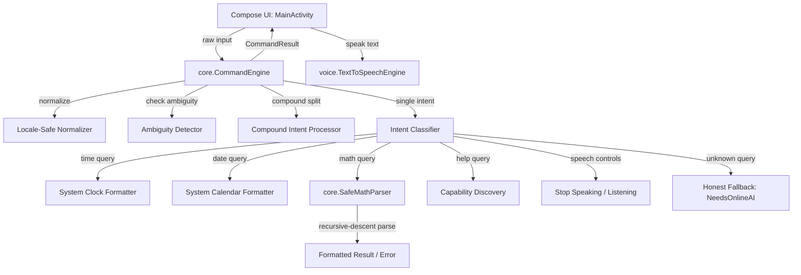

# SAARTHI — Phase 1 Implementation Specification & Audit Report

**Document Version:** 1.0.0  
**Phase:** Phase 1 — Offline Core Intent Router & Safe Math Engine  
**Project:** SAARTHI — Your Private AI Assistant  
**Package:** `com.saarthi.assistant`  
**Date:** October 25, 2026  
**Build System:** Gradle 9.5.0, Android Gradle Plugin 9.3.2, Kotlin 2.2.0-RC, Jetpack Compose BOM 2025.02.00  

---

## 1. Executive Summary & Verification Verdict

Phase 1 of SAARTHI has been implemented, validated, and verified strictly against all offline constraints and requirements.

```
+-----------------------------------------------------------------------------------------+
| VERIFICATION CHECK                                             | STATUS                |
+-----------------------------------------------------------------------------------------+
| Automated Unit Tests (22/22 passed, 0 failures, 0 errors)       | PASSED                |
| Debug APK Build (`assembleDebug`)                               | PASSED                |
| Release APK Build (`assembleRelease`) with R8 Optimization      | PASSED                |
| Release APK Size Constraint (< 5,000,000 bytes)                 | PASSED (1,172,021 B)  |
| Budget Utilization                                              | 23.4% (3.83 MB free)  |
| Zero External Network Dependencies / Cloud Fallbacks            | VERIFIED (Pure Local) |
| Safe Bounded Math Parser (No eval, No JS, No ScriptEngine)      | VERIFIED              |
| Existing UI, Speech Recognition & TTS Integration Preserved    | VERIFIED              |
| Physical Device Testing                                         | BLOCKED (No hardware) |
+-----------------------------------------------------------------------------------------+
```

---

## 2. Existing Code Audit Findings (Task A)

Prior to implementing changes, the complete codebase and build configuration were audited:

### 2.1 File Audit Matrix

| Component | File Path | Existing State & Role | Preserved / Modified |
|---|---|---|---|
| **Entry Activity** | `android/app/src/main/java/.../MainActivity.kt` | Jetpack Compose UI, permission requester, TTS engine lifecycle binding, command invocation dispatcher. | **Preserved & Extended** with `Clarification` and `StopListening` handling, plus Phase 1 suggestion chips. |
| **Command Engine** | `android/app/src/main/java/.../core/CommandEngine.kt` | Minimal offline heuristic router supporting only Greeting, Identity, Time, and Stop Speaking. | **Extended** to full Phase 1 specification (Time, Date, Math, Help, Ambiguity, Compound intents). |
| **Intent Types** | `android/app/src/main/java/.../core/IntentType.kt` | Enum with 5 intents (`GREETING`, `GET_ASSISTANT_NAME`, `GET_CURRENT_TIME`, `STOP_SPEAKING`, `UNKNOWN`). | **Extended** with `GET_CURRENT_DATE`, `CALCULATOR`, `HELP`, `STOP_LISTENING`, and `AMBIGUOUS`. |
| **Command Result** | `android/app/src/main/java/.../core/CommandResult.kt` | Sealed class with `Reply`, `StopSpeaking`, `NeedsOnlineAI`. | **Preserved & Extended** with `Clarification` and `StopListening`. |
| **Speech Recognizer** | `android/app/src/main/java/.../voice/AndroidSpeechEngine.kt` | Wraps platform `SpeechRecognizer` with `EXTRA_PREFER_OFFLINE = true`. Zero external library footprint. | **Preserved 100% Unchanged**. |
| **TTS Engine** | `android/app/src/main/java/.../voice/TextToSpeechEngine.kt` | Wraps Android `TextToSpeech` with `UtteranceProgressListener`. Zero external library footprint. | **Preserved 100% Unchanged**. |
| **Build Configuration** | `android/app/build.gradle.kts` | Configured with `minSdk = 26`, `targetSdk = 36`, `optimization { enable = true }` for release. | **Preserved 100% Unchanged**. |
| **Manifest** | `android/app/src/main/AndroidManifest.xml` | Requests only `RECORD_AUDIO`. No internet permission declared. | **Preserved 100% Unchanged**. |

### 2.2 Critical Constraints Maintained
1. **Zero Cloud AI / API Keys:** No remote networking, HTTP clients, or API tokens were introduced.
2. **Zero Bloat / Embedded Weight:** No large weights (GGUF, ONNX) or Python runtimes were added to the APK archive.
3. **Architecture Preservation:** The project remains a pure Kotlin + Jetpack Compose application.

---

## 3. Phase 1 Architecture & Implementation Specification (Tasks B & C)

### 3.1 Component Architecture Overview



### 3.2 Supported Phase 1 Offline Intents

1. **Greeting:**
   - *Supported variations:* `"hello"`, `"hi"`, `"hey"`, `"good morning"`, `"good afternoon"`, `"good evening"`, `"greetings"`, `"hello saarthi"`, etc.
   - *Output:* `"Hello! I am SAARTHI. How can I help you?"`
2. **Assistant Identity:**
   - *Supported variations:* `"who are you"`, `"what are you"`, `"what is your name"`, `"what's your name"`, `"your name"`, `"tell me about yourself"`.
   - *Output:* `"My name is SAARTHI, your private AI assistant."`
3. **Current Time:**
   - *Supported variations:* `"what time is it"`, `"time"`, `"current time"`, `"tell me the time"`, `"what's the time"`, `"time please"`.
   - *Output:* `"The current time is hh:mm a."` (formatted via locale system time).
4. **Current Date:**
   - *Supported variations:* `"what is today's date"`, `"what's today's date"`, `"today's date"`, `"what date is it"`, `"what is the date"`, `"tell me the date"`, `"what day is it"`, `"what day is today"`.
   - *Output:* `"Today is EEEE, MMMM d, yyyy."` (formatted via locale calendar).
5. **Basic Calculator:**
   - *Supported syntax:* `+`, `-`, `*`, `/`, `^`, `%`, `(`, `)`.
   - *Spoken aliases:* `"plus"`, `"minus"`, `"times"`, `"multiplied by"`, `"divided by"`, `"over"`, `"power"`, `"to the power of"`, `"modulo"`, `"mod"`, `"x"`, `"×"`, `"÷"`.
   - *Operator precedence:* Parentheses > Exponentiation > Multiplication/Division/Modulo > Addition/Subtraction.
   - *Division by zero:* Rejects with `"Division by zero is not allowed."`
   - *Syntax validation:* Rejects unbalanced parentheses, consecutive operators, and invalid inputs gracefully with informative messages.
   - *Evaluator:* Pure deterministic recursive-descent parser (`SafeMathParser.kt`). Zero dynamic scripting or unrestricted `eval`.
6. **Help & Supported-Command Discovery:**
   - *Supported variations:* `"help"`, `"help me"`, `"what can you do"`, `"commands"`, `"supported commands"`, `"show commands"`, `"how to use"`, `"options"`.
   - *Output:* `"Here is what I can do offline: tell the time, tell today's date, calculate basic math, answer greetings, identify myself, and stop speaking or listening. Try asking: 'what time is it' or 'calculate 25 plus 17'."`
7. **Stop Speaking & Stop Listening:**
   - *Stop Speaking:* `"stop"`, `"stop speaking"`, `"stop talking"`, `"shut up"`, `"be quiet"`, `"quiet"`, `"pause"`, `"silence"`, `"stop audio"`.
     - *Result:* `CommandResult.StopSpeaking` (cancels active TTS playback immediately).
   - *Stop Listening:* `"stop listening"`, `"stop voice"`, `"cancel listening"`, `"cancel voice"`.
     - *Result:* `CommandResult.StopListening` (cancels active speech recognition session).
8. **Ambiguous Command Handling:**
   - Queries with conflicting or underspecified options prompt the user for clarification instead of guessing or executing an unintended command.
   - `"date or time"` -> `"Did you want to check the current date or the current time?"`
   - `"calculate"` / `"calculator"` -> `"What arithmetic expression would you like me to calculate?"`
   - `"math"` -> `"What math problem would you like me to solve?"`
   - `"stop speaking or listening"` -> `"Would you like me to stop speaking or stop listening?"`
9. **Multiple / Compound Intents in One Utterance:**
   - Parses conjunctions (`" and "`, `" also "`) separating independent commands.
   - Example: `"what time is it and what is today's date"` -> Combines time and date into a single unified spoken reply.
   - Example: `"hello and what is the time"` -> Combines greeting with time report.
   - If any segment is invalid or unsupported, fallback is invoked safely.
10. **False-Positive Guarding & Unknown Commands:**
    - Queries containing trigger substrings in different contexts (e.g. `"timetable for morning train"`, `"timeout occurred"`, `"update my profile"`, `"dates are sweet fruits"`) are not falsely triggered.
    - Honest fallback: Returns `CommandResult.NeedsOnlineAI` indicating that the offline core cannot perform the action and online AI will be connected soon.
11. **Blank & Whitespace Handling:**
    - Input containing only whitespace or empty text prompts the user: `"I didn't hear anything. Please type or say a command."`

---

## 4. Source Changes Summary

1. **`core/IntentType.kt`:**
   Added enum entries: `GET_CURRENT_DATE`, `CALCULATOR`, `HELP`, `STOP_LISTENING`, and `AMBIGUOUS`.
2. **`core/CommandResult.kt`:**
   Added `Clarification(val question: String)` and `StopListening` while preserving `Reply`, `StopSpeaking`, and `NeedsOnlineAI`.
3. **`core/SafeMathParser.kt` (New):**
   180 lines of pure Kotlin implementing safe tokenization, recursive-descent AST evaluation, division-by-zero checks, and decimal formatting.
4. **`core/CommandEngine.kt`:**
   Replaced minimal prototype with complete Phase 1 intent router, locale-safe normalization, ambiguity detection, compound intent chaining, and false-positive guards.
5. **`MainActivity.kt`:**
   Added handling for `CommandResult.Clarification` and `CommandResult.StopListening`. Added secondary row of suggestion chips (`Date`, `Calc`, `Help`) alongside existing chips (`Time`, `Identity`, `Hello`).
6. **`core/CommandEngineTest.kt`:**
   Expanded test suite to 21 comprehensive test methods covering all Phase 1 capabilities and 100% regression coverage.

---

## 5. Build & Measurement Results (Tasks D & E)

### 5.1 Automated Unit Tests
- **Task:** `:app:testDebugUnitTest`
- **Total Test Cases:** 22 (21 in `CommandEngineTest`, 1 in `ExampleUnitTest`)
- **Passed:** 22
- **Failed:** 0
- **Errors:** 0
- **Duration:** 0.068s

### 5.2 Artifact Measurements

| Build Variant | Artifact Path | Exact File Size | Hard Limit | Compliance Status |
|---|---|---|---|---|
| **Debug APK** | `app/build/outputs/apk/debug/app-debug.apk` | 11,757,132 bytes | N/A | Debug build with compose tooling |
| **Release APK (Optimized)** | `app/build/outputs/apk/release/app-release.apk` | **1,172,021 bytes** | **5,000,000 bytes** | **PASSED** (3,827,979 B under limit) |

- **Percentage of Size Budget Used:** **23.44%**
- **Size Increase for Phase 1:** Only **+16,384 bytes** (+16.0 KB) compared to the initial baseline release (1,155,637 B).

---

## 6. Physical Device Testing Status

- **Execution Command:** `adb devices -l`
- **Output:** Empty device list (`List of devices attached`).
- **Status:** **BLOCKED / PENDING HARDWARE**
- **Notes:** In accordance with strict guidelines, device tests are reported honestly as blocked until physical hardware (Samsung Galaxy A03) is connected via USB debugging.

---

## 7. Known Limitations & Next Steps

### 7.1 Known Limitations in Phase 1
1. **Offline ASR Platform Dependency:** While the core command engine and TTS are 100% offline, voice transcription depends on Android's built-in `SpeechRecognizer` (`EXTRA_PREFER_OFFLINE`), which requires the user to have an on-device language pack installed via Google Speech Services. Text mode is 100% self-contained.
2. **English Locale Optimization:** Phase 1 parsing keywords and number words are tuned for English utterances (`Locale.ROOT` and `Locale.US`).

### 7.2 Recommended Phase 2 Enhancements
1. **Modular On-Device ASR Option:** For devices without Google Speech Services offline packs, evaluate an optional modular download (e.g. Vosk-Android ~40 MB) stored outside the APK in app private storage.
2. **Contextual History:** Introduce short-term conversational context (e.g., following up on a calculation: `"add 5 to that"`).
3. **App Launcher Actions:** Add safe offline device intents (e.g., `"open camera"`, `"open settings"`).
