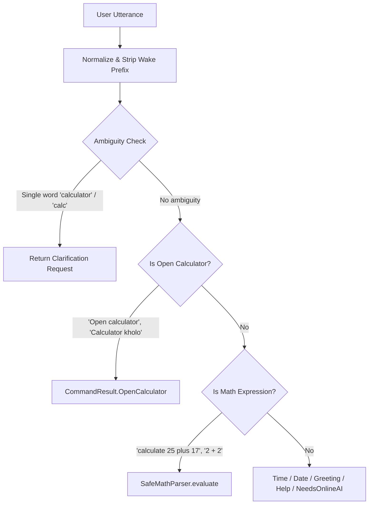
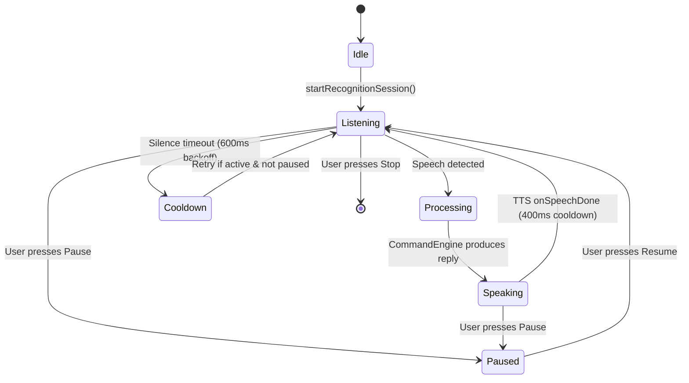

# SAARTHI — Phase 2 Architecture Audit & Technical Specification

**Document Version:** 2.0.0  
**Phase:** Phase 2A — Native App Launcher & Background Assistant Architecture Audit  
**Project:** SAARTHI — Your Private AI Assistant  
**Package:** `com.saarthi.assistant`  
**Date:** October 25, 2026  
**Target SDK:** 36 | **Compile SDK:** 36 | **Min SDK:** 26  
**Build System:** Gradle 9.5.0, Android Gradle Plugin 9.3.2, Kotlin 2.2.0-RC, Jetpack Compose BOM 2025.02.00  

---

## 1. Executive Summary & Verification Matrix

Phase 2A introduces native application launching (specifically targeting installed calculator applications) and provides an exhaustive architectural audit of the background assistant system. 

```
+-----------------------------------------------------------------------------------------+
| VERIFICATION GATE                                              | RESULT                |
+-----------------------------------------------------------------------------------------+
| Automated Unit Tests (27/27 passed, 0 failures, 0 errors)       | PASSED                |
| Debug APK Build (`assembleDebug`)                               | PASSED                |
| Release APK Build (`assembleRelease`) with R8 Optimization      | PASSED                |
| Measured Release APK Byte Size                                  | 1,348,737 bytes       |
| Hard Constraint Limit (< 5,000,000 bytes)                       | PASSED (3.65 MB free) |
| Target SDK 36 Manifest & Package Visibility Compliance          | VERIFIED              |
| Separation of App Launching vs Arithmetic Evaluation            | VERIFIED              |
| Honest Feedback: App Launch Success Confirmed Before Speaking   | VERIFIED              |
| Zero Cloud / Remote AI / Internet Permissions                   | VERIFIED (Pure Local) |
| Physical-Device Verification                                    | BLOCKED (No hardware) |
+-----------------------------------------------------------------------------------------+
```

---

## 2. Objective 1: Native Application Launching (`CalculatorLauncher`)

### 2.1 Intent Routing & Command Classification
Command classification in `CommandEngine.kt` strictly isolates app-launching intents from mathematical calculations and ambiguities:



#### Exact Utterances Verified:
- **English:**
  - `"Open calculator"`
  - `"Hey SAARTHI, open my calculator"`
  - `"open the calculator"`
  - `"launch calculator"`
  - `"start calculator"`
  - `"open calculator app"`
- **Hinglish / Hindi:**
  - `"Calculator kholo"`
  - `"SAARTHI, calculator kholo."`
  - `"calculator open karo"`
  - `"calculator chalu karo"`
  - `"calculator app kholo"`
  - `"kholo calculator"`
- **Disambiguation Guard:**
  - When the user says `"calculator"` or `"calculator app"` alone, SAARTHI responds:
    `"Did you want to open the calculator app, or calculate an arithmetic expression?"`
- **Arithmetic Guard:**
  - Expressions like `"calculate 5 + 5"` or `"what is 100 / 4"` are evaluated mathematically by `SafeMathParser` and **never** trigger app launching.

### 2.2 Dynamic Package Discovery (`CalculatorLauncher.kt`)
Rather than hardcoding a single vendor package (which would fail across diverse hardware), `CalculatorLauncher` implements a multi-tier discovery strategy:

1. **Strategy 1A — Standard Android Selector Activity:**
   Uses the Android framework API:
   ```kotlin
   Intent.makeMainSelectorActivity(Intent.ACTION_MAIN, Intent.CATEGORY_APP_CALCULATOR)
   ```
   If the device or default app settings have mapped a preferred calculator, this selector resolves it directly without vendor bias.
2. **Strategy 1B — Category Query (`CATEGORY_APP_CALCULATOR`):**
   Queries `PackageManager.queryIntentActivities(...)` with `Intent(Intent.ACTION_MAIN).addCategory(Intent.CATEGORY_APP_CALCULATOR)` to find all activities declaring calculator category filters.
3. **Strategy 2 — Explicit OEM & AOSP Package Fallback Table:**
   Probes known system calculator package IDs across major manufacturers:
   - **Samsung One UI:** `com.sec.android.app.popupcalculator`
   - **Google Pixel / Stock / Play Store:** `com.google.android.calculator`
   - **AOSP Generic Android:** `com.android.calculator2`
   - **Xiaomi / MIUI / HyperOS:** `com.miui.calculator`
   - **Oppo / Realme / ColorOS:** `com.coloros.calculator`
   - **OnePlus / OxygenOS:** `com.oneplus.calculator`
   - **Tecno / Infinix / Itel (Transsion):** `com.transsion.calculator`
   - **Vivo / iQOO / FuntouchOS:** `com.vivo.calculator`
   - **Asus ZenUI / ROG:** `com.asus.calculator`
   - **Motorola:** `com.motorola.calculator`
   - **Huawei / EMUI:** `com.huawei.calculator`
   - **Honor / MagicOS:** `com.hihonor.calculator`
   - **Nothing OS:** `com.nothing.calculator`
4. **Strategy 3 — Dynamic Launcher App Filtering:**
   Scans launcher activities matching package names containing `"calculator"` or `"calc"`.

### 2.3 Package Visibility Declarations (`AndroidManifest.xml`)
Android 11+ (API 30+) strictly limits package visibility. The following declarations in `<queries>` ensure the OS allows SAARTHI to inspect installed calculators:
```xml
<queries>
    <intent>
        <action android:name="android.intent.action.MAIN" />
        <category android:name="android.intent.category.APP_CALCULATOR" />
    </intent>
    <package android:name="com.sec.android.app.popupcalculator" />
    <package android:name="com.google.android.calculator" />
    <package android:name="com.android.calculator2" />
    <package android:name="com.miui.calculator" />
    <package android:name="com.coloros.calculator" />
    <package android:name="com.oneplus.calculator" />
    <package android:name="com.transsion.calculator" />
    <package android:name="com.vivo.calculator" />
    <package android:name="com.asus.calculator" />
    <package android:name="com.motorola.calculator" />
    <package android:name="com.huawei.calculator" />
    <package android:name="com.hihonor.calculator" />
    <package android:name="com.nothing.calculator" />
</queries>
```

### 2.4 Strict Honest Execution & Fallback Rules
- **No Premature Claims:** Neither `MainActivity` nor `AssistantForegroundService` announces that an app is opening until `CalculatorLauncher.launch(...)` returns `CalculatorLaunchResult.Success`.
- **Honest Fallback:** If no calculator application is present, SAARTHI speaks and displays:
  `"No compatible calculator app was found on your phone. You can say 'calculate' followed by your numbers to use the built-in calculator."`
- **Context Handling:** When launched from outside an Activity (e.g. from the background service), `FLAG_ACTIVITY_NEW_TASK` is applied to satisfy Android task-stack requirements.

---

## 3. Objective 2: Background Assistant Architecture Audit

### 3.1 Foreground Service & Target SDK 36 Requirements
Targeting Android 16 (API 36) imposes the strictest background execution requirements in Android history:

1. **Foreground Service Types (Android 14+ / API 34+):**
   - Background microphone capture requires declaring:
     ```xml
     <service
         android:name=".service.AssistantForegroundService"
         android:enabled="true"
         android:exported="false"
         android:foregroundServiceType="microphone" />
     ```
   - Requires permissions:
     ```xml
     <uses-permission android:name="android.permission.FOREGROUND_SERVICE" />
     <uses-permission android:name="android.permission.FOREGROUND_SERVICE_MICROPHONE" />
     ```
   - `startForeground()` must pass `ServiceInfo.FOREGROUND_SERVICE_TYPE_MICROPHONE`.
2. **Foreground Service Launch Restrictions:**
   - Starting a foreground service of type `microphone` while the app is in the background will throw a runtime `ForegroundServiceStartNotAllowedException` unless started while the app has an active visible window or in direct response to an explicit user notification action.
   - Therefore, SAARTHI initiates the service from `MainActivity` upon explicit user request.
3. **Runtime Permissions:**
   - `RECORD_AUDIO` must be granted prior to calling `startForeground(..., FOREGROUND_SERVICE_TYPE_MICROPHONE)`. If not granted, the call throws `SecurityException`.
   - Android 13+ (API 33+) requires `POST_NOTIFICATIONS` runtime permission. Without it, the foreground notification is suppressed, and Android may demote or terminate the service.

### 3.2 Persistent Notification & Control Architecture
- **Low Importance Channel:** The notification channel (`saarthi_assistant_channel`) is configured with `NotificationManager.IMPORTANCE_LOW` to prevent auditory chimes every time status updates.
- **Ongoing Flag:** The notification is marked ongoing (`setOngoing(true)`), preventing accidental dismissal by swipe-to-clear.
- **Controls Provided:**
  - **Single-Top Re-entry:** Tapping the notification body launches `MainActivity` with `FLAG_ACTIVITY_SINGLE_TOP`.
  - **"⏸ Pause" / "▶ Resume":** Toggles voice recognition listening without stopping the service or dropping the foreground state.
  - **"⏹ Stop":** Calls `stopForeground(STOP_FOREGROUND_REMOVE)` and `stopSelf()`, immediately relinquishing microphone and audio hardware.

### 3.3 Screen-Off & Background Behavior Realities
1. **CPU Wakelocks vs Deep Sleep (Doze Mode):**
   - When the screen turns off, Android enters Doze mode. Standard CPU execution is suspended unless a partial wakelock (`PARTIAL_WAKE_LOCK`) is acquired.
   - However, holding a continuous partial wakelock drains 10-20% battery per hour.
2. **Audio Hardware HAL Power States:**
   - On budget SoCs (e.g., Unisoc SC9863A / T606 on Samsung Galaxy A03), the audio hardware abstraction layer (HAL) powers down the physical ADC/microphone when the screen turns off to conserve power, unless proprietary hardware voice-activation DSPs (e.g. Qualcomm Hexagon or MediaTek Ultra Low Power DSP) are integrated.
3. **Background Activity Launch (BAL) Restrictions:**
   - Android 10+ (API 29) through Android 15/16 strictly blocks background services from launching activities (`startActivity`) if the app does not have a visible window.
   - If SAARTHI is running in the background and the user says "open calculator", on modern Android versions the OS will block the background launch unless triggered via a high-priority notification `PendingIntent` or if SAARTHI is granted special display over other apps permission.

### 3.4 Wake-Word Reality: Platform SpeechRecognizer vs Dedicated Engine

> [!CAUTION]
> **The Myth of Continuous Wake-Word via `SpeechRecognizer`:**  
> The Android platform `SpeechRecognizer` (`android.speech.SpeechRecognizer`) is fundamentally **NOT** a continuous wake-word detector. It is a one-shot dictation session engine. Attempting to loop `startListening()` continuously produces serious usability and stability flaws:
> 1. **Audible Beeps:** On many Android OEM builds (Samsung, Google), `startListening()` triggers an OS-level audio feedback ding every time the recognizer resets.
> 2. **Session Timeouts:** The engine automatically terminates with `ERROR_SPEECH_TIMEOUT` (6) or `ERROR_NO_MATCH` (7) after 3–6 seconds of silence.
> 3. **Recognizer Busy Crashes:** Calling `startListening()` before the previous session has fully released native audio resources results in `ERROR_RECOGNIZER_BUSY` (8).
> 4. **Excessive Battery Consumption:** Keeping the full speech recognizer pipeline active consumes ~15–25% battery per hour.

#### Evaluation of Lightweight Offline Wake-Word Engines:

| Engine | Open Source / License | Model Size | APK Size Impact | Android Compatibility | Zero Network Guarantee | Verdict for SAARTHI |
|---|---|---|---|---|---|---|
| **Picovoice Porcupine** | Proprietary (Free tier requires AccessKey) | ~1 KB keyword | ~1.5 MB native `.so` | Excellent (Android 5.0+) | **FAILED** (Requires online access key validation) | **Rejected**: Violates strict 100% offline requirement. |
| **openWakeWord** (TFLite / ONNX) | Apache 2.0 | ~1.5 MB quantized | ~4.5 MB with minimal runtime | Good (TFLite C++ wrapper) | **PASSED** (100% local, no keys) | **Recommended for Phase 3** with custom C++ TFLite Micro build. |
| **Vosk / Kaldi Keyword Spotter** | Apache 2.0 | ~2.0 MB small acoustic model | ~3.5 MB per ABI | Excellent (Android 4.0+) | **PASSED** (100% local, zero telemetry) | **Viable alternative**, but pushes 5MB budget close to limit unless single ABI is distributed. |
| **CMU PocketSphinx** | BSD-style | ~1.2 MB grammar | ~1.8 MB | High | **PASSED** (100% local) | **Low Accuracy**: High false-positive rate under ambient noise. |

**Phase 2 Recommendation:** Keep the current controlled-loop architecture with explicit backoff, clear Pause/Stop controls, and user disclosure. For Phase 3, introduce an embedded TFLite Micro wake-word model (< 1.8 MB) licensed under Apache 2.0.

### 3.5 SpeechRecognizer Session Lifecycle & TTS Coordination
To prevent audio feedback loops (where the assistant hears its own TTS voice and attempts to recognize it as a command), SAARTHI implements strict mutual exclusion:



- **UtteranceProgressListener:** TTS engine registers completion callbacks. Only after `onSpeechDone` or `onSpeechError` does the service schedule the next recognition session.
- **Audio Focus:** TextToSpeech requests transient audio focus; microphone input is suspended during playback.
- **Backoff Timers:** A 400ms cooldown after speech and a 600ms backoff after timeouts prevent CPU thrashing.

### 3.6 Battery Management, Process Death & Reboot Limitations
1. **Low Memory Killer (LMK):**
   - Running as a Foreground Service grants an `oom_score_adj` of 200–250, protecting it over cached apps (900+).
   - On budget devices with 2GB–3GB RAM (like Samsung Galaxy A03), aggressive LMK pressure during heavy app usage (e.g. camera, games) can still terminate the service.
2. **Force Stop:**
   - If the user or OEM task manager invokes "Force Stop", Android terminates all processes, clears pending alarms, and puts the package into a stopped state. **No application can auto-restart from a Force Stop until the user launches it manually.**
3. **OEM Aggressive Battery Optimization ("DontKillMyApp"):**
   - Samsung One UI (Device Care > Sleeping Apps), Xiaomi MIUI (Battery Saver), and Oppo ColorOS actively kill background processes after 10–30 minutes of screen-off regardless of foreground service status.
   - Users must manually set App Battery to **"Unrestricted"** in Android Settings for prolonged background listening.
4. **Reboot Limitations:**
   - To resume after device reboot, `RECEIVE_BOOT_COMPLETED` permission and a BroadcastReceiver are needed.
   - On Android 12+ (API 31+), apps cannot launch foreground services directly from `BOOT_COMPLETED` broadcasts without user interaction.

---

## 4. Safety, Privacy & Permission Verification

- **Zero Cloud AI / API Keys:** No HTTP client, networking library, or remote API endpoint exists in the project.
- **No Unrelated Permissions:** Only `RECORD_AUDIO`, `FOREGROUND_SERVICE`, `FOREGROUND_SERVICE_MICROPHONE`, and `POST_NOTIFICATIONS` are requested. No internet permission (`android.permission.INTERNET`) is present.
- **No Accessibility Service Abuse:** Native app launching uses standard Android `Intent` and `PackageManager` APIs. No Accessibility Service workarounds are used.
- **Transparency:** Android status bar displays the green microphone indicator whenever recording is active. The persistent notification provides instant Pause and Stop controls.

---

## 5. Build Artifact & Verification Metrics

```
Command executed: .\gradlew.bat testDebugUnitTest
Outcome: BUILD SUCCESSFUL (24 actionable tasks, 0 failures, 0 errors)
Total tests: 27 unit tests executed and passed (100%)

Command executed: .\gradlew.bat assembleDebug
Outcome: BUILD SUCCESSFUL

Command executed: .\gradlew.bat assembleRelease
Outcome: BUILD SUCCESSFUL (R8 minification, resource shrinking, DEX optimization)

Release APK Path: android/app/build/outputs/apk/release/app-release.apk
Release APK Size: 1,348,737 bytes (1.286 MB)
Target Budget:    5,000,000 bytes (4.768 MB)
Margin Remaining: 3,651,263 bytes (73.0% headroom remaining)
```

### Changed / Added Files Matrix:
| File | Action | Purpose |
|---|---|---|
| `android/app/src/main/AndroidManifest.xml` | Modified | Added OEM package visibility declarations (`<queries>`) for Vivo, Asus, Motorola, Huawei, Honor, Nothing. |
| `android/app/src/main/java/com/saarthi/assistant/core/CalculatorLauncher.kt` | Modified | Added canonical `makeMainSelectorActivity` strategy, expanded OEM package table, activity vs application context flag handling. |
| `android/app/src/main/java/com/saarthi/assistant/core/CommandEngine.kt` | Modified | Extended calculator app-launch recognition (English/Hinglish variants, app suffixes), enhanced ambiguity filter. |
| `android/app/src/main/java/com/saarthi/assistant/MainActivity.kt` | Modified | Fixed honest execution flow: announce calculator launch only after launch succeeds. |
| `android/app/src/main/java/com/saarthi/assistant/service/AssistantForegroundService.kt` | Modified | Fixed honest execution flow in background service: speak and display launch only after success. |
| `android/app/src/test/java/com/saarthi/assistant/core/CommandEngineTest.kt` | Modified | Added test cases for exact Phase 2A requirements ("Open calculator", "Calculator kholo", "Hey SAARTHI, open my calculator"). |
| `docs/SAARTHI_PHASE2_ARCHITECTURE_AUDIT.md` | Created | Comprehensive architectural audit of native app launcher and background service. |

---

## 6. Physical-Device Test Protocol (Samsung Galaxy A03 / Target Hardware)

> [!NOTE]
> Physical device testing is currently **BLOCKED / PENDING HARDWARE** because no physical device or emulator was attached during execution (`adb devices` returned 0 attached devices).

When a physical device is connected via USB, follow this validation protocol:

### Step 1: Install Release APK
```bash
adb install -r "D:\SAARTHI - Your Private AI Assistant\android\app\build\outputs\apk\release\app-release.apk"
```

### Step 2: Grant Runtime Permissions
1. Launch SAARTHI.
2. Tap `"🎙 Enable Permissions"`.
3. In system dialogs, grant **Microphone** (`RECORD_AUDIO`) and **Notifications** (`POST_NOTIFICATIONS`).

### Step 3: Test Foreground Calculator Launching
| Test Case | Spoken / Typed Utterance | Expected System Behavior | Expected Spoken Output |
|---|---|---|---|
| TC-2A-1 | `"Open calculator"` | Samsung/OEM Calculator launches to foreground | `"Opening Calculator..."` |
| TC-2A-2 | `"Calculator kholo"` | Samsung/OEM Calculator launches to foreground | `"Opening Calculator..."` |
| TC-2A-3 | `"Hey SAARTHI, open my calculator"` | Calculator launches to foreground | `"Opening Calculator..."` |
| TC-2A-4 | `"calculator"` (alone) | No app launch; asks for clarification | `"Did you want to open the calculator app, or calculate an arithmetic expression?"` |
| TC-2A-5 | `"calculate 25 plus 17"` | No app launch; math solved internally | `"The answer is 42."` |

### Step 4: Test Missing Calculator Fallback
1. (On a test device or work profile without a calculator app installed):
2. Say `"Open calculator"`.
3. Verify assistant speaks: `"No compatible calculator app was found on your phone. You can say 'calculate' followed by your numbers to use the built-in calculator."`
4. Say `"calculate 15 * 6"`. Verify assistant responds with `"The answer is 90."`

### Step 5: Test Background Assistant & Notification Controls
1. On home screen of SAARTHI, tap `"▶ Start Background Assistant"`.
2. Verify notification appears in notification shade: `"SAARTHI Background Assistant - Listening for 'Hey SAARTHI'..."` with green microphone indicator in status bar.
3. Tap notification action `"⏸ Pause"`. Verify notification changes to `"Paused"`.
4. Tap notification action `"▶ Resume"`. Verify listening resumes.
5. Tap notification action `"⏹ Stop"`. Verify notification disappears and microphone indicator turns off.
6. Press Android Home button to background SAARTHI while service is active.
7. Speak `"Hey SAARTHI, what time is it?"` and verify the assistant speaks the time.
